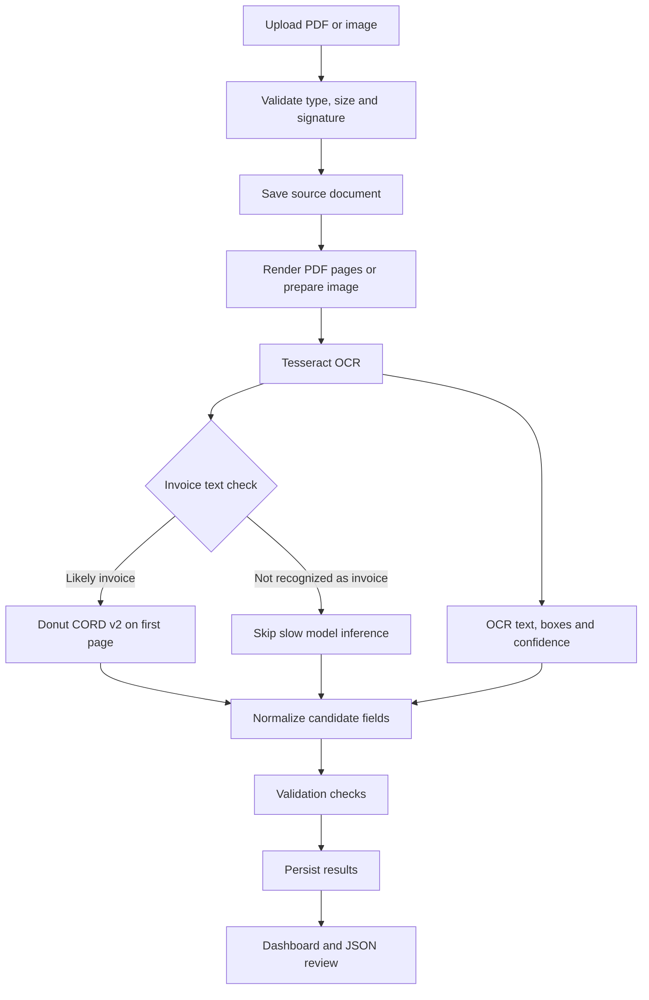
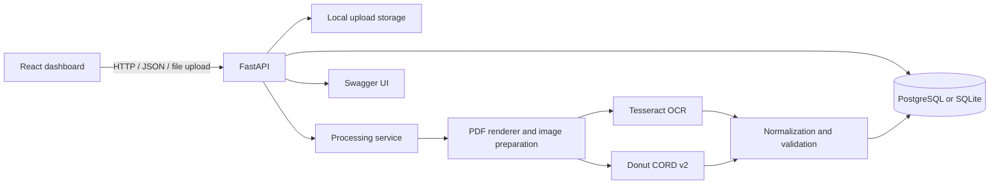

# Papertrail — Intelligent Document Understanding

<p align="center">
  <strong>Turn invoice PDFs and images into reviewable, structured data.</strong><br />
  A full-stack document AI project combining OCR, pretrained visual document understanding, validation, a REST API, and a web dashboard.
</p>

<p align="center">
  
  
  
  
</p>

> **Project scope:** This is an academic demonstration of invoice document processing. It proposes fields for human review; it does not certify invoice correctness or replace accounting controls.

## Contents

- [Why this project?](#why-this-project)
- [What it does](#what-it-does)
- [How processing works](#how-processing-works)
- [Features](#features)
- [Technology](#technology)
- [Architecture](#architecture)
- [Quick start](#quick-start)
- [Try the demo](#try-the-demo)
- [Configuration](#configuration)
- [REST API](#rest-api)
- [Data and evaluation](#data-and-evaluation)
- [Limitations and responsible use](#limitations-and-responsible-use)
- [Project layout](#project-layout)
- [Future work](#future-work)
- [Author](#author)

## Why this project?

Invoices are visually inconsistent documents. A business may receive PDFs, scans, and photos with different layouts, labels, and table structures. Re-entering every value by hand takes time, while a fixed template or a few positional rules can fail as soon as a supplier changes its design.

This project explores a document AI workflow that combines text recognition with a pretrained visual document model. It makes the intermediate evidence visible, normalizes likely values, and checks basic consistency so that a person can review the result instead of treating a model prediction as unquestioned fact.

The project demonstrates how to connect a machine-learning model to a practical application: file handling, OCR, inference, data normalization, validation, persistence, an API, and a user interface.

## What it does

1. Accepts an invoice PDF or image through the Papertrail dashboard or REST API.
2. Checks the file type, size, MIME type, and file signature before saving it.
3. Runs Tesseract OCR to produce page text, word-level bounding boxes, and OCR confidence values.
4. For documents that pass a conservative invoice text check, runs Donut CORD v2 on the first page to produce a visual document-understanding prediction.
5. Normalizes candidate dates and amounts and labels their source, such as model output or OCR-derived candidate.
6. Checks fields for missing values, malformed dates, low model confidence, and arithmetic inconsistencies.
7. Saves the original file and processing results so the user can inspect the document history, preview the source, review extracted fields, and export JSON.

An unrecognized field stays empty. The interface separates model extraction confidence from OCR engine confidence and warns that neither score establishes correctness.

## How processing works



### Extraction details

- **OCR:** PDF pages are rasterized with Poppler. Images are EXIF-corrected, converted to RGB, and small images are upscaled before Tesseract runs. OCR is performed on up to `MAX_PDF_PAGES` pages.
- **Visual model:** `naver-clova-ix/donut-base-finetuned-cord-v2` generates structured text from the first page image. OCR text is not passed in as the model's visual input. The repository uses published pretrained weights; it does not train or fine-tune them.
- **Normalization:** A CORD-shaped response is mapped to the application's invoice fields, and dates and numeric amounts are normalized. Explicit OCR label candidates can fill some missing values. The raw model output is retained separately from these normalized candidates.
- **Validation:** Checks report basic issues such as missing invoice number/currency, invalid dates, low sequence confidence, or a subtotal/tax/total mismatch. A validation warning is not a legal, tax, or accounting audit.
- **Persistence:** SQLAlchemy stores document metadata and JSON results. Uploaded bytes are saved separately under `UPLOAD_DIR`.

## Features

### Document workspace

- Upload or drag and drop a supported invoice file.
- View recent uploads and processing status.
- Preview the original document and inspect OCR text and extraction details.
- Review candidate invoice fields and validation warnings.
- Export a document's normalized fields and raw extraction as JSON.
- Delete a document and its stored source file.

### Backend and processing

- Versioned FastAPI endpoints and interactive Swagger documentation.
- PDF and common image support with page-aware OCR.
- OCR word coordinates and per-word engine confidence.
- Pretrained Donut visual document inference with a non-invoice pre-check.
- Field provenance, date/amount normalization, and basic consistency validation.
- PostgreSQL support for the Compose setup and SQLite for a simple local demo.
- Synthetic invoice samples and a script for evaluating predictions against user-supplied labels.

## Technology

| Layer | Tools |
| --- | --- |
| Frontend | React, TypeScript, Vite, Lucide |
| API | Python 3.11, FastAPI, Pydantic Settings, Uvicorn |
| Document processing | Tesseract OCR, Poppler, Pillow, pdf2image |
| Deep learning | PyTorch, Hugging Face Transformers, Donut CORD v2 |
| Persistence | SQLAlchemy 2, PostgreSQL, SQLite, Alembic baseline |
| Local deployment | Docker Compose |

## Architecture



More implementation notes, data flow, confidence semantics, database fields, and project-report notes are in [docs/architecture.md](docs/architecture.md).

### Confidence and provenance

The Donut decoder's mean selected-token probability is a **sequence-level** score, not a calibrated probability for each extracted field. A field copied from Donut shares that approximate indicator. An OCR-only candidate has no extraction confidence. Tesseract's word confidence is a separate OCR-engine measurement. Neither number guarantees that a value is correct; review the source document.

## Quick start

### Prerequisites

- Python 3.11
- Node.js 20 or newer and npm
- Tesseract OCR installed locally and available on `PATH`
- Poppler for Windows installed and its `Library/bin` directory available on `PATH` for local PDF processing
- Internet access for the first Donut model download

Docker is optional. For a local run, SQLite avoids setting up a separate database. Donut inference works on CPU, though the first run can take several minutes while the model downloads and loads; later requests can still take noticeable time on CPU.

### Windows PowerShell setup

Run these commands from the project root:

```powershell
Copy-Item .env.example .env
Copy-Item frontend\.env.example frontend\.env
py -3.11 -m venv .venv
.\.venv\Scripts\Activate.ps1
python -m pip install --upgrade pip
pip install -r backend\requirements.txt
python backend\scripts\generate_sample.py
```

If PowerShell blocks activation, use `\.venv\Scripts\python.exe` for the remaining Python commands instead of activating the environment. Set `TESSERACT_CMD` in `.env` if the Tesseract executable is not found automatically. Install Poppler and add its `Library/bin` directory to `PATH` if PDF processing reports that `pdfinfo` or `pdftoppm` is missing.

### Start the backend

In a PowerShell window at the project root:

```powershell
$env:PYTHONPATH = (Resolve-Path .\backend).Path
uvicorn app.main:app --app-dir backend --reload
```

The API runs at `http://localhost:8000`. The app creates the SQLite database tables on startup for local development.

### Start the frontend

Open another PowerShell window:

```powershell
Push-Location frontend
npm install
npm --script-shell=powershell.exe run dev
Pop-Location
```

Open **http://localhost:5173**. The default frontend API URL is `http://localhost:8000/api/v1`.

### Start with Docker Compose

Docker Compose starts PostgreSQL, the API, and the web UI:

```powershell
docker compose up --build
```

- Dashboard: `http://localhost:5173`
- API: `http://localhost:8000`
- Swagger UI: `http://localhost:8000/docs`

Compose persists PostgreSQL data, uploaded documents, and the Hugging Face model cache in named volumes. The first inference still requires downloading the model weights.

## Try the demo

Generate the included synthetic sample set:

```powershell
python backend\scripts\generate_sample.py
```

The generator creates files under `sample_data/`: a clean invoice PDF and PNG, an alternate layout, a low-quality JPEG, and a multipage PDF. Upload `sample_data/clean_invoice.pdf` or `sample_data/clean_invoice.png` from the dashboard to see the end-to-end flow. The clean example is synthetic and is not an evaluation benchmark. Its visible fields are documented in [sample_data/expected/clean_invoice.json](sample_data/expected/clean_invoice.json).

There is also a separately generated synthetic invoice at [`output/pdf/stellar_analytics_invoice.pdf`](output/pdf/stellar_analytics_invoice.pdf) with a different vendor, customer, invoice number, and totals. It can be used as an additional upload example when that file is present in the workspace.

To regenerate that second invoice, install the development dependencies (which include ReportLab) and run:

```powershell
pip install -r backend\requirements-dev.txt
python backend\scripts\generate_stellar_invoice.py
```

### Upload and process through the API

With the backend running and sample files generated:

```powershell
$uploaded = curl.exe -sS -F "file=@sample_data/clean_invoice.png;type=image/png" http://localhost:8000/api/v1/documents/upload | ConvertFrom-Json
$id = $uploaded.id
$result = Invoke-RestMethod -Method Post -Uri "http://localhost:8000/api/v1/documents/$id/process"
$result | ConvertTo-Json -Depth 10
```

The processing response includes OCR text and words, raw model output, normalized fields, validation, processing status, and elapsed time. The pretrained model's first use can be slow because its checkpoint must be downloaded. Review its output in the dashboard and compare candidates with the invoice itself.

## Configuration

Backend defaults are listed in [.env.example](.env.example); the frontend API URL is in [frontend/.env.example](frontend/.env.example).

| Variable | Default | Purpose |
| --- | --- | --- |
| `DATABASE_URL` | `sqlite:///./data/documents.db` | SQLAlchemy connection string; Compose supplies PostgreSQL. |
| `UPLOAD_DIR` | `./data/uploads` | Location for source documents. |
| `MAX_FILE_SIZE` | `15728640` | Upload limit in bytes (15 MiB). |
| `MODEL_NAME` | `naver-clova-ix/donut-base-finetuned-cord-v2` | Hugging Face model identifier. |
| `ENABLE_DONUT` | `true` | Enables the visual inference model. |
| `DEVICE` | `auto` | Model device selection. |
| `MAX_MODEL_TOKENS` | `256` | Maximum generated sequence length. |
| `CONFIDENCE_THRESHOLD` | `0.55` | Threshold used by validation warnings. |
| `TESSERACT_CMD` | *(auto-detected)* | Optional path to the Tesseract executable. |
| `PDF_DPI` | `180` | Resolution used when rasterizing PDF pages. |
| `MAX_PDF_PAGES` | `20` | Maximum number of pages read by OCR. |
| `CORS_ORIGINS` | `http://localhost:5173` | Comma-separated allowed frontend origins. |
| `VITE_API_URL` | `http://localhost:8000/api/v1` | Frontend API base URL. |

Donut receives only page one, even when OCR reads multiple pages. Increasing token length or PDF DPI can affect processing time and resource use.

## REST API

Interactive request and response schemas are available at **http://localhost:8000/docs** after starting the API.

| Method | Endpoint | Purpose |
| --- | --- | --- |
| `GET` | `/api/v1/health` | API, database, and model status. |
| `POST` | `/api/v1/documents/upload` | Upload a file using multipart field `file`. |
| `POST` | `/api/v1/documents/{id}/process` | Run OCR, model inference when applicable, and validation. |
| `GET` | `/api/v1/documents` | List recent documents (`limit` and `offset` supported). |
| `GET` | `/api/v1/documents/{id}` | Retrieve one document record and its results. |
| `GET` | `/api/v1/documents/{id}/file` | Preview the stored source file inline. |
| `DELETE` | `/api/v1/documents/{id}` | Delete a record and its source file. |

Supported uploads are PDF, PNG, JPEG, TIFF, and WebP. The default size limit is 15 MiB. Upload handling checks the extension, declared MIME type, and signature bytes.

## Data and evaluation

The repository includes **synthetic** invoices for manual demos and a small expected-content file for the clean sample. These examples are not a representative dataset, and no invoice accuracy, precision, recall, or F1 score is claimed.

To calculate field metrics, prepare a JSON Lines file with a prediction and ground truth on each line:

```json
{"prediction":{"invoice_number":"INV-100","total":118.0},"truth":{"invoice_number":"INV-100","total":118.0}}
```

Then run:

```powershell
python backend\scripts\evaluate.py path\to\labeled-results.jsonl
```

The script reports field-level exact match, precision, recall, F1, and support. For meaningful results, use a held-out set of varied invoices, verify labels manually, and report OCR quality and processing latency separately. Only use documents you have permission to process.

## Limitations and responsible use

- Donut CORD v2 was fine-tuned for receipts, not invoices. It may omit, misread, or misclassify invoice fields.
- The model is pretrained and downloaded on first use; the checkpoint is large, and CPU inference may be slow.
- Donut processes only the first page. OCR can cover more pages, but cross-page invoice reasoning is not implemented.
- Sequence confidence is not a calibrated field probability. OCR confidence reflects text recognition, not semantic correctness.
- The invoice pre-check is a conservative OCR keyword rule, not a trained classifier. An unusual invoice may be skipped if its text does not match the check.
- Validation checks only implemented field and arithmetic rules. It does not verify a company, tax registration, payment status, fraud, or legal compliance.
- The app is a local academic demo. It has no authentication or multi-tenant access controls and should not be exposed publicly with sensitive documents.
- No accuracy claim is supported by the included synthetic samples.

Always verify important extracted information against the source document before using it for payment, accounting, or compliance decisions.

## Project layout

```text
.
├── backend/
│   ├── app/
│   │   ├── api/          # FastAPI document routes
│   │   ├── core/         # Settings and logging
│   │   ├── database/     # SQLAlchemy models and sessions
│   │   ├── ml/           # Donut inference adapter
│   │   ├── ocr/          # Tesseract OCR pipeline
│   │   ├── services/     # Processing, normalization, validation
│   │   └── utils/        # Upload validation and file helpers
│   ├── migrations/       # Alembic migration baseline
│   ├── scripts/          # Sample generator and evaluation script
│   └── tests/            # Backend and API tests
├── docs/                 # Architecture and project report notes
├── frontend/
│   └── src/              # React dashboard and API client
├── sample_data/          # Synthetic invoice samples and expected fields
├── docker-compose.yml
└── README.md
```

## Tests and code quality

Install development dependencies and run the project checks from the repository root:

```powershell
$env:PYTHONPATH = (Resolve-Path .\backend).Path
pip install -r backend\requirements-dev.txt
python -m pytest backend\tests -q
ruff check backend\app backend\tests backend\scripts backend\migrations
ruff format --check backend\app backend\tests backend\scripts backend\migrations
Push-Location frontend
npm --script-shell=powershell.exe run format:check
npm --script-shell=powershell.exe run build
Pop-Location
```

The test suite covers API behavior, upload validation, normalization, validation rules, and representative model-output mapping. A mocked model-output mapping test is not an end-to-end evaluation of the downloaded Donut checkpoint.

## Future work

- Build and annotate a diverse, permission-cleared invoice dataset.
- Fine-tune or compare invoice-focused document models and publish measured field-level results.
- Add multi-page field linking and table extraction evaluation.
- Add a human correction workflow and an audit trail for reviewed changes.
- Calibrate per-field confidence against a labeled validation set.
- Move long-running inference to an asynchronous job queue and report progress to the UI.
- Add authentication, retention controls, and deployment security before handling real business documents.

## Author

**Hruthvik K M**

- GitHub: [@hruthvikkm6](https://github.com/hruthvikkm6)
- LinkedIn: [hruthvikkm](https://linkedin.com/in/hruthvikkm)

---

Created for educational, portfolio, and demonstration purposes.
