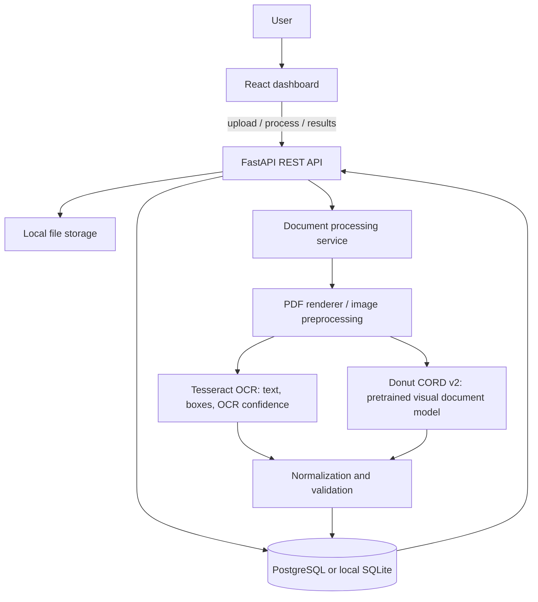

# System architecture

## Components

- **React + Vite UI:** upload, processing actions, document history, structured fields, confidence provenance, OCR text and JSON export.
- **FastAPI:** versioned REST endpoints and Swagger UI. Uploaded bytes are capped, extension and declared MIME type are checked, file signatures are checked, and storage names are generated independently from user filenames.
- **Storage:** original documents live under `UPLOAD_DIR`; metadata, OCR output, raw model output, normalized fields and validation are JSON-capable SQLAlchemy columns. PostgreSQL is the deployment default; SQLite is available for a zero-service local demo.
- **OCR:** Tesseract runs per page and returns recognized words with pixel bounding boxes and engine confidence. PDF pages are rendered with Poppler; EXIF orientation is applied to images and small images are upscaled.
- **Document understanding:** a conservative OCR keyword pre-check skips obvious non-invoices before model inference. For invoices, `naver-clova-ix/donut-base-finetuned-cord-v2` runs visual encoder-decoder inference on the first page and parses generated CORD output. It is a publicly pretrained receipt model; this project does not fine-tune it. CORD is a receipt benchmark, so invoice semantics and layouts can be out of domain. Missing model fields remain null.
- **Normalization and validation:** deterministic date/amount normalization and explicit OCR label/header candidates can populate or replace weak model candidates. Each value records whether it came from Donut or OCR; OCR-derived fields have no fabricated extraction confidence, and the raw model response is retained unchanged. Arithmetic/confidence checks report warnings without changing raw output.

## Data flow and confidence

Donut generation has a mean selected-token probability available from decoding; the UI calls it **sequence confidence** because it is not a calibrated probability for each field. Where a field is taken from Donut, that sequence score is used as an approximate shared indicator. OCR-only candidates show no extraction confidence. OCR word confidence is provided separately by Tesseract. Neither score means the extracted value is correct; human review remains appropriate.

The raw OCR words, raw Donut JSON and normalized fields are stored independently. The database status reflects whether processing ran, while validation status reflects implemented checks only.

The non-invoice pre-check is a deterministic routing guard based on invoice labels, not a learned document classifier. It skips Donut for obvious non-invoice text, avoiding long and meaningless receipt-model generations on resumes or unrelated PDFs. Unusual invoice templates may not contain these labels and can be skipped; this limitation appears in the validation issue.

## Database entity

`documents` stores UUID, safe display filename, server-generated storage filename, MIME type, size, timestamps, overall/OCR/extraction statuses, normalized fields, raw model output, OCR text and words, validation report, elapsed milliseconds and a non-sensitive user-facing failure message. Stack traces are only written to server logs.

The Alembic baseline is in `backend/migrations`; the development app creates tables on startup for convenience.

## API

- `GET /api/v1/health`
- `POST /api/v1/documents/upload` (multipart field `file`)
- `POST /api/v1/documents/{id}/process`
- `GET /api/v1/documents` (limit/offset)
- `GET /api/v1/documents/{id}`
- `GET /api/v1/documents/{id}/file` (inline preview)
- `DELETE /api/v1/documents/{id}`
- Interactive docs: `/docs`

## Project report notes

- **Problem:** extracting reliable invoice data from varying visual layouts is difficult with fixed templates and manual entry.
- **Existing system:** manual keying or template/rule-only OCR systems are brittle when labels and positions change.
- **Proposed system:** OCR with layout boxes plus a pretrained visual document transformer, followed by transparent normalization and checks.
- **Objectives:** accept PDFs/images, retain OCR evidence, produce structured invoice candidates, report confidence provenance, validate basic consistency, persist results and expose a demonstrable API/UI.
- **Methodology:** PDF rasterization/image normalization → Tesseract OCR → Donut CORD visual inference → alias mapping and normalization → validation → persistence and review UI.
- **Modules:** upload/storage, OCR, model inference, normalization, validation, persistence/API, dashboard.
- **Data:** the included demo invoice is synthetically generated. No private or copyrighted documents are bundled. It is not a labeled evaluation corpus.
- **Evaluation:** `backend/scripts/evaluate.py` measures field exact match, precision, recall and F1 against a user-supplied labeled JSONL file. No accuracy claim is made from the included sample.
- **Limitations:** pretrained model is tuned for receipts rather than invoices; inference may be slow on CPU and requires a first-run Hugging Face download; only the first PDF page is sent to Donut while OCR covers up to the configured page limit; extraction fields may be missing or wrong; not production-secure multi-tenant service; no user correction/audit trail yet.
- **Future scope:** annotated invoice dataset, fine-tuning Donut/LayoutLM, multi-page cross-page field linking, calibrated field-level confidence, human correction workflow, async job queue, stronger auth/retention controls, and measured domain evaluation.

